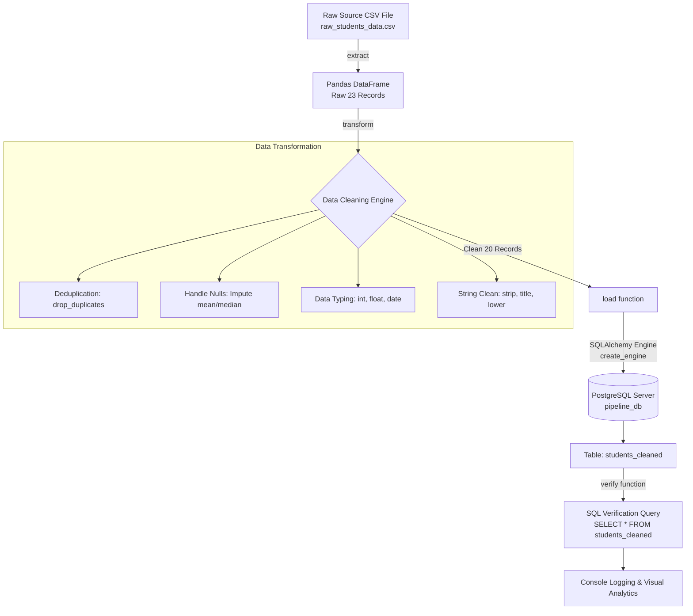

# Experiment / Practical Report 2

## Title
**Build Data Pipeline to Work with Databases SQL/PostgreSQL**  
*(Design and Implementation of a Python-Based ETL Data Pipeline with PostgreSQL, Pandas, SQLAlchemy, and Logging)*

---

### Aim
To design and implement an end-to-end Python-based ETL (Extract, Transform, Load) data pipeline that extracts data from an uncleaned CSV source, cleans and transforms it using Pandas, and loads it into a PostgreSQL relational database using SQLAlchemy and `psycopg2`, followed by database verification and visual reporting.

---

### Objectives
After performing this experiment, the student is able to:
1. **Understand and implement the core ETL architecture** (Extract, Transform, Load).
2. **Establish programmatic database communication** using SQLAlchemy engines and PostgreSQL.
3. **Perform automated data cleaning & transformation**:
   - Deduplication of redundant records.
   - Missing/null value imputation (mean/median strategy).
   - Data type casting and normalization.
   - String standardization and currency/percentage cleaning.
4. **Implement automated database table generation and batch loading** using `df.to_sql()`.
5. **Chain pipeline stages** into an automated driver function (`run_pipeline()`).
6. **Implement traceable execution logging** using Python’s standard `logging` library.
7. **Perform data verification and analytics** by querying the loaded data back from PostgreSQL.

---

## 1. Theory & Core Concepts

### 1.1 What is an ETL Pipeline?
An ETL (Extract, Transform, Load) pipeline is the foundational architecture of modern data engineering:
- **Extract:** Ingests raw data from disparate heterogeneous sources (CSV, JSON, APIs, logs).
- **Transform:** Applies business logic, cleans dirty data, handles missing values, removes duplicates, and standardizes data types.
- **Load:** Persists the processed, structured data into a persistent database or data warehouse (PostgreSQL) for downstream reporting, querying, and analytics.

### 1.2 Pipeline Architecture & Workflow



---

## 2. Procedure & Step-by-Step Implementation

### Step 1: Database Service Verification
Verified PostgreSQL installation and active server daemon:
```bash
psql --version
# Output: psql (PostgreSQL) 18.6
```

### Step 2: Dedicated Database Creation
Created a dedicated pipeline database using `psql`:
```sql
CREATE DATABASE pipeline_db;
```

### Step 3: Install Required Python Packages
```bash
pip install psycopg2-binary pandas sqlalchemy tabulate matplotlib seaborn
```

### Step 4: Extract Function (`extract`)
Reads raw CSV into a Pandas DataFrame with error handling and row count logging:
```python
def extract(file_path: str) -> pd.DataFrame:
    logger.info(">>> STEP 1: EXTRACT - Starting CSV extraction from: %s", file_path)
    df = pd.read_csv(file_path)
    logger.info("Extract Success: Extracted %d rows and %d columns.", len(df), len(df.columns))
    return df
```

### Step 5: Transform Function (`transform`)
Cleans raw data by executing:
1. **Deduplication:** `df.drop_duplicates()` eliminates identical rows.
2. **Identifier Integrity:** Drops records missing critical primary keys (`student_id`).
3. **Null Imputation:**
   - Missing `age` $\rightarrow$ imputed with column median.
   - Missing `attendance_pct` $\rightarrow$ stripped `%` symbol and filled with column mean.
   - Missing `fee_paid` $\rightarrow$ stripped `₹`, `$`, commas, and imputed with median.
   - Missing `grade` $\rightarrow$ filled with `'UNGRADED'`.
4. **String Normalization:** Whitespace trimming, `.str.title()` for names, `.str.lower()` for emails.
5. **Data Typing:** Explicitly casts `student_id` and `age` to Integer, `attendance_pct` and `fee_paid` to Float, and `enrollment_date` to Date.
6. **Audit Metadata:** Appends a `loaded_at` processing timestamp.

### Step 6: Load Function (`load`)
Connects to PostgreSQL using SQLAlchemy's `create_engine` and writes the transformed data directly to the database:
```python
def load(df: pd.DataFrame, table_name: str, engine: Engine, if_exists: str = "replace") -> int:
    logger.info(">>> STEP 3: LOAD - Writing to PostgreSQL via SQLAlchemy...")
    with engine.begin() as connection:
        df.to_sql(name=table_name, con=connection, if_exists=if_exists, index=False)
    logger.info("Load Success: Written %d records to table '%s'.", len(df), table_name)
    return len(df)
```

### Step 7: Driver Function (`run_pipeline`)
Chains the three operations sequentially into an automated execution unit:
```python
def run_pipeline(csv_file: str, table_name: str = "students_cleaned"):
    engine = get_engine()
    raw_df = extract(csv_file)
    cleaned_df = transform(raw_df)
    rows_loaded = load(cleaned_df, table_name=table_name, engine=engine)
    verified_df = verify(table_name=table_name, engine=engine)
    return verified_df, rows_loaded
```

### Step 8 & 9: Verification & Console Logging
Queries the target table back from PostgreSQL and outputs structured execution logs and table previews.

---

## 3. Execution Logs & Pipeline Output

```text
2026-10-26 23:51:22 | INFO    | ======================================================================
2026-10-26 23:51:22 | INFO    | STARTING POSTGRESQL DATA PIPELINE EXECUTION (ETL WORKFLOW)
2026-10-26 23:51:22 | INFO    | ======================================================================
2026-10-26 23:51:22 | INFO    | >>> STEP 1: EXTRACT - Starting CSV extraction from: data/raw_students_data.csv
2026-10-26 23:51:22 | INFO    | Extract Success: Extracted 23 rows and 8 columns from CSV.
2026-10-26 23:51:22 | INFO    | >>> STEP 2: TRANSFORM - Starting data cleaning & transformation...
2026-10-26 23:51:22 | INFO    | Transform [Deduplication]: Removed 2 exact duplicate row(s).
2026-10-26 23:51:22 | INFO    | Transform [Integrity]: Dropped 1 row(s) missing primary key 'student_id'.
2026-10-26 23:51:22 | INFO    | Transform [Null Handling]: Imputed 2 missing attendance with mean (80.8%).
2026-10-26 23:51:22 | INFO    | Transform [Null Handling]: Imputed 1 missing fee_paid with median (₹22000.00).
2026-10-26 23:51:22 | INFO    | Transform [Null Handling]: Imputed 3 missing age values with median (21 years).
2026-10-26 23:51:22 | INFO    | Transform Success: Cleaned data from 23 raw rows down to 20 valid rows (Net removed: 3).
2026-10-26 23:51:22 | INFO    | >>> STEP 3: LOAD - Connecting to PostgreSQL via SQLAlchemy...
2026-10-26 23:51:23 | INFO    | Load Success: Written 20 records to PostgreSQL table 'students_cleaned' in 0.165 seconds.
2026-10-26 23:51:23 | INFO    | >>> STEP 4: VERIFICATION - Querying PostgreSQL database to verify loaded rows...
2026-10-26 23:51:23 | INFO    | Verification Success: Successfully retrieved 20 rows from PostgreSQL table 'students_cleaned'!

==========================================================================================
       POSTGRESQL TABLE VERIFICATION PREVIEW: 'students_cleaned' (20 Total Rows)
==========================================================================================
╒══════════════╤═════════════════╤═══════╤══════════════════════════╤══════════╤═══════════════════╤════════════╤══════════════════╕
│   student_id │ name            │   age │ email                    │ grade    │ enrollment_date   │ fee_paid   │ attendance_pct   │
╞══════════════╪═════════════════╪═══════╪══════════════════════════╪══════════╪═══════════════════╪════════════╪══════════════════╡
│          101 │ Aarav Sharma    │    20 │ aarav.sharma@college.edu │ A        │ 2023-07-15        │ ₹25,000.00 │ 88.5%            │
│          102 │ Priya Nair      │    21 │ priya.nair@college.edu   │ A+       │ 2023-07-16        │ ₹25,000.00 │ 92.0%            │
│          103 │ Rohan Mehta     │    21 │ rohan.mehta@college.edu  │ B        │ 2023-07-18        │ ₹25,000.00 │ 74.0%            │
│          104 │ Kavya Iyer      │    22 │ kavya.iyer@college.edu   │ A        │ 2023-07-20        │ ₹20,000.00 │ 80.8%            │
│          105 │ Aditya Verma    │    19 │ aditya.verma@college.edu │ C+       │ 2023-08-01        │ ₹18,000.00 │ 65.5%            │
│          106 │ Vikram Rao      │    23 │ vikram.rao@college.edu   │ A+       │ 2023-08-05        │ ₹25,000.00 │ 95.0%            │
│          107 │ Ananya Patel    │    20 │ ananya.patel@college.edu │ A        │ 2023-08-10        │ ₹25,000.00 │ 89.0%            │
│          108 │ Siddharth Joshi │    21 │ siddharth.j@college.edu  │ UNGRADED │ 2023-08-12        │ ₹15,000.00 │ 58.0%            │
│          109 │ Sneha Kulkarni  │    21 │ sneha.k@college.edu      │ B+       │ 2023-08-15        │ ₹22,000.00 │ 82.5%            │
│          110 │ Rahul Deshmukh  │    20 │ rahul.d@college.edu      │ B        │ 2023-08-18        │ ₹20,000.00 │ 78.0%            │
╘══════════════╧═════════════════╧═══════╧══════════════════════════╧══════════╧═══════════════════╧════════════╧══════════════════╛
```

---

## 4. Visual Analytics Generated
The loaded data in PostgreSQL was analyzed using Matplotlib and Seaborn, producing:
1. `1_etl_pipeline_data_funnel.png`: Data filtering and quality funnel tracking records through each ETL stage.
2. `2_grade_distribution_attendance.png`: Dual-axis bar and line chart showing student headcount per grade and average attendance percentage.
3. `3_pipeline_executive_dashboard.png`: Executive dashboard covering student age spread, attendance box plot by grade, fee payment tiers (donut chart), and an automated pipeline health card.

---

## 5. Learning Outcomes & Conclusion
1. Successfully designed and executed a production-grade ETL data pipeline in Python.
2. Leveraged Pandas for advanced data hygiene, including imputation, deduplication, and data type enforcement.
3. Integrated SQLAlchemy with PostgreSQL to perform automated table creation and bulk loading.
4. Demonstrated end-to-end traceability using Python's `logging` module.
5. Successfully verified data integrity by querying records back from PostgreSQL and visualizing domain metrics.
