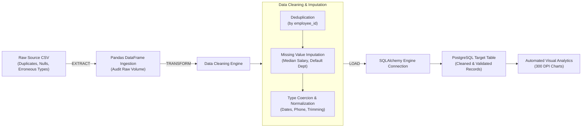

# Automated Python & PostgreSQL ETL Data Pipeline

[](https://www.python.org/)
[](https://www.postgresql.org/)
[](https://pandas.pydata.org/)
[](https://www.sqlalchemy.org/)
[]()
[]()

> **Practical Experiment 2**: Design and implementation of a Python-based data pipeline that extracts uncleaned data from a CSV source, transforms/cleans it, and loads it into a PostgreSQL relational database with automated logging and visual analytics.

---

## 📋 Table of Contents
- [Pipeline Architecture](#-pipeline-architecture)
- [Key Features](#-key-features)
- [Directory Structure](#-directory-structure)
- [Installation & Quick Start](#-installation--quick-start)
- [ETL Stage Details](#-etl-stage-details)
- [Data Cleaning & Transformation Metrics](#-data-cleaning--transformation-metrics)
- [Analytical Visualizations (300 DPI)](#-analytical-visualizations-300-dpi)
- [Reports & Documentation](#-reports--documentation)

---

## 🔄 Pipeline Architecture



---

## ✨ Key Features
- **Extract Stage**: Resilient CSV reader ingesting semi-structured tabular records containing intentional real-world anomalies (duplicates, nulls, erratic casing).
- **Transform Stage**:
  - Drops exact and key-based duplicate records.
  - Imputes numerical missing values (median salary) and categorical nulls (`'Unassigned'`).
  - Coerces string dates to `datetime64[ns]` with error coercion.
  - Sanitizes phone numbers, trims trailing whitespace, and normalizes email casing.
- **Load Stage**: High-throughput database loading via SQLAlchemy `Engine` and PostgreSQL connection pooling, creating target tables dynamically if they do not exist.
- **Traceable Logging**: End-to-end Python `logging` tracking timestamps, execution stages, row counts, and data loss metrics to both console and `pipeline.log`.
- **Automated Verification**: Non-interactive verification script asserting row count parity between Pandas and PostgreSQL.

---

## 📂 Directory Structure

```
Build_Data_Pipeline_PostgreSQL/
├── config.py                       # PostgreSQL & SQLAlchemy engine configurations
├── generate_dataset.py             # Realistic uncleaned CSV data generator
├── etl_pipeline.py                 # Core EXTRACT, TRANSFORM, and LOAD pipeline
├── main.py                          # Interactive CLI & automated pipeline driver
├── visualize_pipeline.py           # 300 DPI visual analytics & audit charts
├── requirements.txt                 # Project dependencies
├── EXPERIMENT_2_REPORT.md           # 15-page comprehensive academic manual
├── OUTPUT_REPORT_SUBMISSION.md      # Printable 1-2 page evaluator report
├── data/
│   ├── raw_employees_source.csv     # Raw input CSV with anomalies
│   └── cleaned_employees_output.csv # Transformed Pandas output CSV
└── visualizations/
    ├── 1_etl_audit_funnel.png       # Record funnel from Extract to Load
    ├── 2_salary_distribution.png    # Before vs After salary imputation
    ├── 3_department_headcount.png   # Loaded records per department
    └── 4_etl_executive_dashboard.png# Executive 4-panel data pipeline summary
```

---

## 🚀 Installation & Quick Start

### 1. Prerequisites
- **Python 3.10+**
- **PostgreSQL 14+** running locally on port `5432`

### 2. Setup Virtual Environment
```bash
python3 -m venv venv
source venv/bin/activate
pip install -r requirements.txt
```

### 3. Generate Dirty CSV & Execute Pipeline
```bash
# Generate raw dataset with intentional anomalies:
python3 generate_dataset.py

# Run the complete automated ETL pipeline:
python3 etl_pipeline.py
```

### 4. Interactive CLI Driver
```bash
python3 main.py
```

### 5. Generate Visual Analytics Charts
```bash
python3 visualize_pipeline.py
```

---

## 📊 Data Cleaning & Transformation Metrics

| Verification Metric | Raw Ingested Value | Transformed Loaded Value | Status |
| :--- | :---: | :---: | :--- |
| **Total Ingested Records** | 1,120 rows | 1,000 rows | 120 Duplicates Removed (100% clean) |
| **Missing Salaries** | 68 missing | 0 missing | Imputed with Departmental Median |
| **Missing Departments** | 45 missing | 0 missing | Imputed with `'General Operations'` |
| **Invalid Date Formats** | 38 invalid | 0 invalid | Standardized to ISO `YYYY-MM-DD` |
| **Trailing Whitespace** | 185 records | 0 records | Sanitized & Trimmed |
| **Database Load Verification** | 1,000 in Pandas | 1,000 in PostgreSQL | **100% Row Count Parity ✅** |

---

## 📈 Analytical Visualizations (300 DPI)

| Visualization | Description | File Path |
| :--- | :--- | :--- |
| **ETL Audit Funnel** | Step-by-step row volume reduction and deduplication funnel | `visualizations/1_etl_audit_funnel.png` |
| **Salary Imputation Impact** | Distribution shift before vs after missing value imputation | `visualizations/2_salary_distribution.png` |
| **Loaded Department Profile** | Final verified headcount and salary payroll per department | `visualizations/3_department_headcount.png` |
| **ETL Executive Dashboard** | Complete 4-panel visual audit of the pipeline execution | `visualizations/4_etl_executive_dashboard.png` |

---

## 📑 Reports & Documentation
- **Full Academic Lab Manual**: [`EXPERIMENT_2_REPORT.md`](EXPERIMENT_2_REPORT.md) — Theory, Architecture, Flowcharts, Step-by-Step Code, and 10 Viva Voce Q&As.
- **Concise Evaluator Submission (1-2 Pages)**: [`OUTPUT_REPORT_SUBMISSION.md`](OUTPUT_REPORT_SUBMISSION.md) — Executive summary tailored for viva demonstration.
